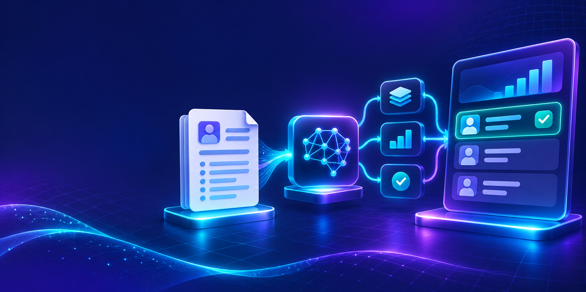
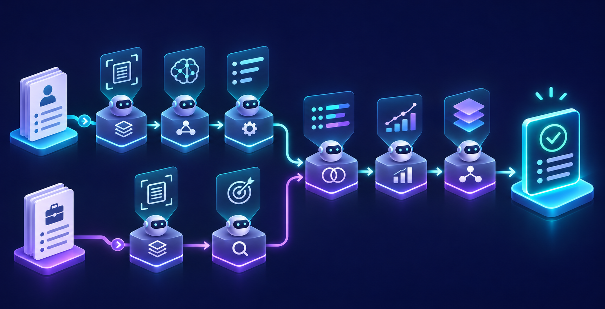

# AI Resume Screening System



<p align="center">
  <strong>Intelligent, explainable resume screening powered by collaborative AI agents.</strong><br>
  Transform resumes and job descriptions into structured insights, transparent matching, and confident next-step recommendations.
</p>

<p align="center">
  
  
  
  
</p>

## Overview

AI Resume Screening is a modern multi-agent system for evaluating candidates against job descriptions. Each stage of the process has a focused responsibility, and the workflow combines those insights into a structured, human-readable screening result.

It is designed to make resume evaluation faster, more consistent, and easier to understand—while keeping the reasoning behind every recommendation visible.

## Why this project stands out

- **Collaborative AI architecture** — specialized agents work together instead of relying on one oversized prompt.
- **Explainable recommendations** — results include match scores, confidence, reasoning, flags, and detailed analysis.
- **Structured intelligence** — Pydantic models keep information consistent as it moves through the workflow.
- **Parallel workflow execution** — independent analysis paths run concurrently through LangGraph.
- **Human-in-the-loop by design** — uncertain or borderline results are clearly surfaced for review.
- **Flexible document support** — work with PDF, DOCX, or TXT resumes through one simple interface.
- **Provider flexibility** — use Google Gemini or Groq through environment-based configuration.
- **Developer-friendly CLI** — run one-off screenings, interactive sessions, or machine-readable JSON output.

## Architecture



The workflow is organized into focused stages:

| Stage | Responsibility |
| --- | --- |
| Document Parser | Extract readable text from the source resume |
| Resume Parser Agent | Structure contact details, education, experience, projects, and certifications |
| Skill Extractor Agent | Identify, normalize, categorize, and assess candidate skills |
| Job Analyzer Agent | Convert a job description into structured requirements |
| Skills Matcher Agent | Compare candidate capabilities with required and preferred skills |
| Experience Evaluator Agent | Assess relevance, seniority, progression, and experience gaps |
| Decision Synthesizer Agent | Combine all signals into a final recommendation |

The result is a clean `ScreeningOutput` object that can be displayed in the terminal or consumed by another application.

## Core capabilities

### Intelligent resume understanding

Extract meaningful candidate information from resumes and organize it into reusable structured data.

### Requirement-aware matching

Separate required skills, preferred skills, responsibilities, education, certifications, and experience expectations before evaluating fit.

### Transparent decision making

Every screening includes:

- Match score
- Recommendation
- Confidence score
- Human-review indicator
- Reasoning summary
- Skills analysis
- Experience analysis
- Actionable flags

### Production-minded foundations

The project includes typed models, isolated agents, configurable providers, graceful error handling, sample data, JSON output, and a focused test suite—making it easy to extend into a larger recruiting workflow.

## Quick start

### 1. Install dependencies

```bash
pip install -r requirements.txt
```

### 2. Configure an LLM provider

Copy `.env.example` to `.env` and choose Gemini or Groq:

```env
LLM_PROVIDER=gemini
GEMINI_API_KEY=your_gemini_key_here
```

Or:

```env
LLM_PROVIDER=groq
GROQ_API_KEY=your_groq_key_here
```

Optional model settings:

```env
GEMINI_MODEL=gemini-2.0-flash
GROQ_MODEL=llama-3.3-70b-versatile
TEMPERATURE=0.3
MAX_TOKENS=4096
```

### 3. Screen a resume

Using a job description file:

```bash
python run.py --resume sample_data/resumes/senior_python_dev.txt --job-file sample_data/job_descriptions/backend_engineer.txt
```

Using inline job text:

```bash
python run.py --resume sample_data/resumes/senior_python_dev.txt --job "Looking for a Python backend engineer with API and cloud experience."
```

For automation and integrations:

```bash
python run.py --resume resume.pdf --job-file job.txt --json > output.json
```

## Example result

```json
{
  "match_score": 0.86,
  "recommendation": "Proceed to technical interview",
  "requires_human": false,
  "confidence": 0.91,
  "reasoning_summary": "Strong alignment with the role's backend, Python, and API requirements.",
  "skills_analysis": "Required skills are strongly covered with several semantic matches.",
  "experience_analysis": "Relevant experience demonstrates increasing ownership and technical depth.",
  "flags": []
}
```

## Project structure

```text
.
├── run.py                         # Command-line entry point
├── requirements.txt               # Python dependencies
├── .env.example                   # Configuration template
├── src/
│   ├── config.py                  # Provider and threshold configuration
│   ├── document_parser.py         # PDF, DOCX, and TXT extraction
│   ├── models.py                  # Pydantic data contracts
│   ├── workflow.py                # LangGraph orchestration
│   └── agents/                    # Specialized screening agents
├── sample_data/                   # Example resumes and job descriptions
├── sample_outputs/                # Example JSON screening results
├── assets/                        # README visuals
└── tests/                         # Workflow and model tests
```

## Testing

Run the test suite with:

```bash
python -m pytest tests/ -v
```

The repository includes coverage for model validation, workflow setup, document parsing behavior, agent contracts, and screening output boundaries.

## Extensibility

The modular workflow makes it straightforward to add new capabilities such as:

- Batch screening for multiple candidates
- Resume and result caching
- OCR-assisted document processing
- Interview question generation
- Candidate ranking and comparison
- ATS or recruiting-platform integrations
- Feedback-driven evaluation improvements
- Bias-aware job description analysis

## License

Released under the MIT License.
